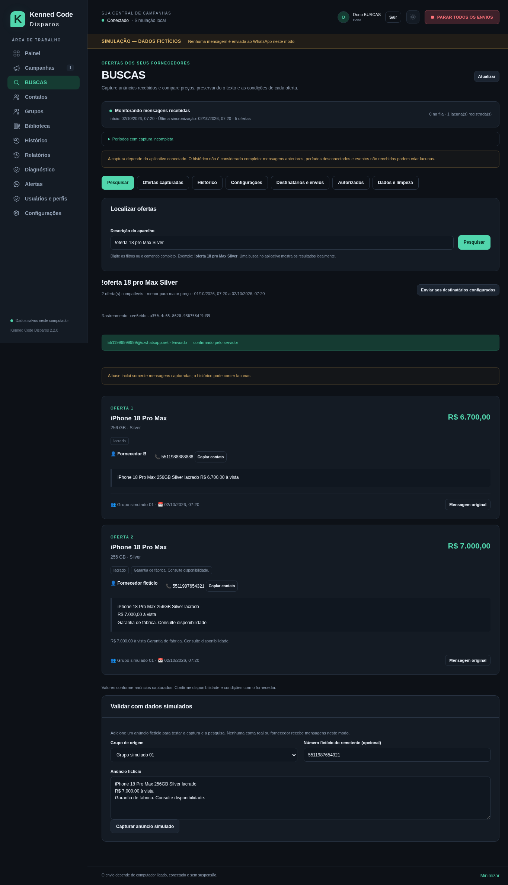

# Instalação e uso da versão 3.0.0

## Instalar ou atualizar

1. No Windows 10/11 de 64 bits, encerre a versão anterior pelo menu da bandeja e execute **Kenned-Code-Disparos-Setup-3.0.0-x64.exe**. Para atualizar, mantenha a pasta dedicada usada anteriormente: **Mega Disparos** continua aceita. Em uma instalação nova, a pasta padrão é **Kenned Code Disparos**. O atalho e a identidade passam a Kenned Code Disparos; o perfil local antigo é preservado. O instalador inclui o runtime e cria o atalho no menu Iniciar; o atalho na área de trabalho é opcional.
2. No primeiro acesso, cadastre o **Dono** com usuário e senha de pelo menos 12 caracteres. Guarde os oito códigos de recuperação apresentados uma única vez, fora dos backups comuns. Em uma atualização, campanhas, mídias e configurações anteriores são preservadas e o banco é migrado com cópia de segurança em `backups`.
3. Em uma instalação nova, teste em **SIMULAÇÃO — DADOS FICTÍCIOS**. A campanha de exemplo tem 15 grupos fictícios, rodadas a cada 10 minutos, espaçamento de 5 segundos e começa desativada. Campanhas anteriores em execução ficam pausadas após a reabertura.

A atualização para 3.0.0 preserva campanhas, arquivos, usuários, configurações e credenciais e migra o banco para esquema 8, com cópia anterior à migração. **BUSCAS começa desativado em instalação nova** e mantém as configurações existentes em atualização; selecionar grupos para monitorar ofertas não altera os destinos das campanhas.

O Windows pode exibir um aviso de editor desconhecido, pois o instalador não tem assinatura de código. Não é preciso instalar Node.js ou usar terminal.

## Criar campanha e conectar

Abra **Campanhas → Nova campanha/Editar**. Adicione textos, emojis, links e arquivos, organize a ordem, selecione destinos e configure dias, janela de horário, datas e limites. Os arquivos são copiados para a biblioteca gerenciada. Escolha repetir o conjunto ou alternar um item por rodada. O intervalo entre rodadas e o espaçamento entre envios são campos diferentes. Salve, visualize a prévia e confirme a ativação; salvar nunca inicia os envios.

Para conectar uma conta real, leia [INTEGRACAO.md](INTEGRACAO.md), selecione WhatsApp em **Configurações**, reconheça que Baileys é **não oficial** e salve. Use Conectar/Reconectar. No celular, leia o QR em WhatsApp → Aparelhos conectados → Conectar aparelho. Atualize **Grupos** e autorize apenas aqueles em que tem permissão para publicar. A campanha real deve selecionar os grupos carregados dessa conta, sem destinos simulados. Ao sair da simulação, suas campanhas, ofertas, contatos e indicadores fictícios ficam fora das telas e consultas do modo real. Os dados reais permanecem preservados. Sem grupos carregados, a tela mostra o estado vazio e a opção de sincronizar; falhas de conexão são exibidas sem substituição por grupos de exemplo.

Em **Usuários**, vincule o telefone de cada operador, com país e DDD. Em Configurações, cadastre os números autorizados para o controle. De outro número cadastrado, em conversa privada com a conta conectada, envie `!mega ajuda` ou `!mega menu`. Os comandos administrativos exigem a permissão **Controlar automação** (`automation.control`), além das permissões específicas de campanha; estar autorizado a pesquisar não concede esse controle. Ativação e alterações de campanhas ativas pedem resumo e confirmação com código de uso único. Mensagens de grupos, encaminhadas, históricas, respostas automáticas ou sem identidade verificável são ignoradas. Um comando manual pela própria conta só é admitido quando a integração comprova sua identidade e a autorização correspondente.

## Usuários e recuperação de senha

O administrador autorizado usa **Usuários → Novo usuário** para cadastrar e aprovar acessos. Selecione Dono, Administrador, Responsável ou Vendedor, ou crie um perfil próprio. A matriz de permissões permite separar visualizar, criar, editar, excluir, iniciar, pausar e encerrar. O vendedor pode acessar apenas suas campanhas ou todas as permitidas. Desativar acesso e editar permissões passa a valer também no backend e nos comandos WhatsApp. O último dono ativo não pode ser excluído ou desativado.

Uma senha temporária pode exigir troca no primeiro login. Para recuperar outro usuário, um administrador autorizado usa **Recuperar senha** e entrega o código temporário ao titular por um meio privado. Na tela de login, a recuperação aceita usuário, código e nova senha; o código só pode ser usado uma vez. O dono pode usar um dos códigos offline guardados no primeiro acesso. Os códigos e as senhas não estão incluídos no backup comum.

Sair do login protege a interface; campanhas já ativadas continuam no serviço em segundo plano. Para interromper uma campanha, use Pausar/Encerrar dentro do seu escopo. **PARAR TODOS OS ENVIOS** é uma operação global que exige `automation.control` e também bloqueia buscas automáticas, alertas privados e lembretes até retomada explícita.

## Configurar BUSCAS

1. Entre com o **Dono** e abra **BUSCAS → Configurações**. Cadastre primeiro, em Usuários, o telefone real do dono que receberá resultados, com código do país e DDD.
2. Selecione os **Grupos monitorados** onde recebe anúncios dos fornecedores. Em outra lista, selecione os **Grupos que aceitam comandos**. Você pode monitorar um grupo sem aceitar comandos nele e habilitar comandos em um grupo que não será capturado.
3. Para comandos privados, deixe habilitada a opção correspondente. Em instalação nova, ela começa habilitada; uma configuração anterior desativada é preservada e a tela avisa que o privado está bloqueado. Uma lista de conversas privadas vazia aceita somente pessoas já autorizadas; uma lista preenchida restringe também os números permitidos. Para executar pelo próprio WhatsApp conectado, vincule o telefone autenticado ao usuário **Dono** e habilite comandos próprios/conversa consigo mesmo. Os números precisam pertencer a usuários locais ativos. O nome exibido não concede acesso.
4. Mantenha `!busca` ou altere o prefixo. O exemplo da tela acompanha a alteração. Escolha até dez resultados. A **idade máxima da oferta** começa em **2 horas**: às 15h, a pesquisa considera anúncios desde as 13h. Você pode trocar o valor e escolher minutos/horas ou desativar esse filtro. Períodos personalizados continuam restringindo a consulta, e mensagens já removidas pela retenção não reaparecem. O fuso inicial é **America/Sao_Paulo**; a idade usa a data original da mensagem, inclusive quando o anúncio foi editado ou chegou atrasado.
5. Escolha **Menor preço**, **Maior preço** ou **Oferta mais recente** e filtros por modelo, armazenamento, condição, fornecedor e grupo. Na aba Pesquisar, essas escolhas são persistidas ao pesquisar; as preferências gerais são salvas em Configurações. Defina também retenção, sinônimos, bloqueios, limite de buscas por pessoa e, se desejado, um resultado por fornecedor. O critério padrão considera o **preço total anunciado à vista**; ofertas sem preço confirmado não entram no ranking.
6. **Uma solicitação recebida no privado responde somente à pessoa autorizada que a enviou, na mesma conversa**, sem usar os destinatários gerais. As opções Privado do dono, solicitante, responsáveis cadastrados ou origem explícita são usadas para comandos feitos em grupos e entregas iniciadas no aplicativo. Publicar na origem exige habilitação adicional. Não há contato automático com fornecedores. Use **Testar envio** para cada destinatário configurado. Números precisam ter país e DDD; um destino inválido gera falha visível e não é trocado silenciosamente por outro chat.
7. Ative o módulo, salve e mantenha o aplicativo conectado. A tela mostra início, última sincronização, fila e lacunas. Atualizar a tela não consulta repetidamente o histórico do WhatsApp. Em todas as seleções de grupos, **Selecionar todos os exibidos** e **Desmarcar os exibidos** atuam nos resultados do filtro atual; seleções fora do filtro permanecem. O contador informa o total selecionado. Apenas grupos reais carregados aparecem no modo real.

Em **BUSCAS → Autorizados**, o dono ou uma pessoa com gestão explícita do módulo seleciona usuários locais ativos, concede Buscar, Consultar histórico, Alterar filtros e/ou Gerenciar o módulo, e pode editar, desativar ou remover os acessos. O perfil em **Usuários** também precisa das permissões BUSCAS correspondentes. Apenas ser administrador do grupo, fornecedor monitorado ou ter um nome conhecido não concede acesso. Usuários desativados ou com troca obrigatória de senha pendente não podem usar o módulo. Comandos não autorizados são ignorados silenciosamente.

## Pesquisar pelo WhatsApp e pelo aplicativo

Em um local habilitado e a partir de um usuário autorizado, envie:

```text
!busca 18 pro Max Silver
!busca iPhone 18 Pro Max 256GB Silver
!busca iPhone 15 128GB lacrado
!busca Samsung S24 Ultra 256GB
```

O dono também pode enviar o comando manualmente pela própria conta conectada, na conversa consigo mesmo habilitada ou em outro local expressamente autorizado. Ecos das mensagens automáticas do aplicativo são ignorados por identificador persistente e não formam loops. O prefixo deve estar no início. Maiúsculas e minúsculas são equivalentes; `ProMax`/`Pro Max` e `Silver`/`Prata` são reconhecidos. Enviar apenas `!busca` dá uma orientação curta. Ao mudar o prefixo, use o novo comando; os comandos antigos de campanhas continuam com `!mega`.

Para pesquisar do seu número particular, cadastre esse número em um usuário ativo e autorize o usuário em BUSCAS. Envie `!busca iPhone 15 Pro Max 256GB` no privado do número conectado ao aplicativo. A resposta deve voltar **a esse número particular**. Não precisa selecionar seu número como destinatário geral. Se não responder, confira módulo ativo, conexão, permissão Buscar, opção de privados, eventual lista restrita e o rastreamento em Diagnóstico; o aplicativo mostra falha em vez de preencher resultados fictícios.

Modelo e versão são obrigatoriamente compatíveis. Quando capacidade, cor ou condição não forem filtradas, cada resultado mostra o que foi anunciado ou “não informado”. Para restringir, acrescente capacidade/cor/condição ao comando ou ajuste filtros na tela. Filtros desconhecidos pedem esclarecimento; não ampliam silenciosamente a busca para outros modelos. O resultado tem até dez ofertas; se houver menos, retorna somente elas. Sem compatíveis, informa a ausência.

Em **BUSCAS → Pesquisar**, descreva o aparelho e consulte localmente. A ação **Enviar aos destinatários configurados** registra uma entrega explícita; pesquisar na tela não publica no WhatsApp por conta própria. Em modo Simulação, o formulário de anúncio fictício permite testar captura e ranking sem conectar conta ou contactar ninguém.

Os resultados incluem preço anunciado, fornecedor, número real quando disponível, trecho original, condições, grupo e data da mensagem. Nome salvo e nome exibido aparecem separados quando diferentes. **Número indisponível** significa que a integração não entregou telefone confiável; o aplicativo não converte LID em número. Telefone escrito na oferta é mostrado como contato informado, sem substituir a identidade do remetente. Encaminhamentos mostram que a identidade do fornecedor original pode ser desconhecida. A informação é um anúncio capturado: confirme disponibilidade e condições com o fornecedor.

A resposta usa **🔎 RESULTADO DA BUSCA**, período e ordenação, com preço destacado em cada oferta. Cor, condição, contato, grupo, data e trecho aparecem conforme os dados disponíveis. Não haver ofertas compatíveis produz uma resposta clara; o sistema não completa a lista com outros aparelhos.

## Revisar ofertas, captura e dados de BUSCAS

Em **Ofertas capturadas**, filtre associações confirmadas ou aguardando revisão. Listas claras geram uma oferta por aparelho/capacidade/cor. Parcelas, entradas, descontos e acessórios não são considerados preço total. “A partir de”, compra mínima e lote mantêm seus qualificadores e exigem o critério correspondente. Associação ambígua fica fora do ranking. Use **Mensagem original** para conferir o texto local e **Revisar dados**, com permissão de gestão, somente após verificar o anúncio; não invente preço nem características.

A publicação mais recente do mesmo fornecedor e combinação de modelo, capacidade, cor e condição prevalece sobre a anterior, mesmo que o preço antigo fosse menor. Condições diferentes continuam separadas. Indisponibilidade elimina a oferta anterior somente quando a associação é inequívoca. Edições e exclusões são aplicadas quando os eventos chegam; não há garantia de receber mudanças durante períodos sem conexão.

**Histórico** registra solicitante, origem, filtros, horário e resultado da pesquisa. Entregas mostram o destinatário e podem estar pendentes, confirmadas pelo servidor, entregues quando houver recibo, falhas ou incertas. Enfileirar não significa enviado. ACK do serviço confirma submissão; não comprova leitura. Consulte o motivo das falhas e use **Tentar novamente** somente quando a falha for comprovadamente anterior à submissão; incertezas exigem revisão. Ao desconectar, a captura fica desatualizada e resultados exibem o aviso. Entregas ainda não submetidas podem sair após reconexão; as incertas exigem revisão e não são repetidas automaticamente.

Em **Dados e limpeza**, as duas ações têm efeitos diferentes:

- **Apagar histórico de buscas:** remove os registros visíveis das consultas e preserva mensagens, ofertas e controles de entrega/deduplicação.
- **Excluir base de ofertas:** remove mensagens/anúncios capturados e ofertas, esvaziando a pesquisa. Preserva campanhas, mídias, usuários, configurações, histórico de consultas, auditoria e controles operacionais.

Confira a prévia e digite **APAGAR**. Essas ações exigem gestão explícita e ficam em auditoria; a limpeza geral de históricos de campanhas não substitui essa limpeza. A retenção elimina mensagens antigas e ofertas associadas; por isso a base pode ser menor que o período desejado para a busca.

Importação de histórico anterior é **parcial e oportunista**. Habilitá-la permite aproveitar apenas os eventos que a integração realmente disponibilizar. Ela não recupera tudo de grupos/comunidades nem garante preencher lacunas. Aplicativo fechado, desconexão, grupos inacessíveis e filas excedidas podem deixar períodos sem captura. Leia [BUSCAS-INTEGRACAO.md](BUSCAS-INTEGRACAO.md).

## Falhas, avisos e sons

Em **Alertas privados**, cadastre destinatários com país e DDD e use **Enviar alerta de teste**. Selecione os destinatários e responsáveis no editor de cada campanha. Donos ativos com telefone cadastrado também recebem os avisos. Uma falha registra separadamente a ocorrência, o motivo, o horário original e o resultado de cada privado. O teste usa a mesma fila e resolução de destino dos avisos reais; uma solicitação de teste não equivale a confirmação de envio. O teste cria um aviso privado; não ativa campanhas. Em modo WhatsApp real, o botão envia uma mensagem ao destinatário selecionado: use somente números de teste autorizados.

Se a conexão estiver indisponível, o aviso local aparece imediatamente e o privado fica pendente. Quando houver reconexão, ele mantém o horário original da falha. A parada global preserva o aviso local, mas bloqueia novas filas privadas e cancela pendências. **Confirmado pelo servidor** representa ACK da integração; **entregue** só aparece quando chega recibo de entrega. Alertas incertos exigem revisão e não são repetidos automaticamente. Em Configurações, ajuste de 1 a 5 tentativas e intervalo de 3 a 3.600 segundos para falhas temporárias anteriores à submissão. Alertas ligados a uma campanha usam a política dessa campanha; os demais usam a política geral. Não há tentativas infinitas.

Em **Configurações**, escolha notificações nativas, tentativas e intervalo de reconexão. A retomada automática é opcional e começa desativada: ela só considera campanhas pausadas pela conexão, sem conteúdo alterado ou resultado incerto. Sessão expirada pode exigir novo QR. O aviso interno mostra o horário, motivo conhecido e **Reconectar WhatsApp**.

Configure volume entre 0% e 100%, eventos sonoros, som suave/urgente ou importe WAV, MP3 ou OGG de até 20 MiB. Use um clipe curto, de até 15 segundos: o tempo máximo de reprodução protege a fila de sons; um arquivo que não termine nesse prazo é interrompido e o teste indica falha. Use **Testar som**, ajuste repetição e horário silencioso e silencie uma ocorrência na tela de alertas. O aplicativo evita sons simultâneos. O volume e o mudo do Windows continuam valendo. Notificações e sons dependem do aplicativo em execução, inclusive na bandeja, e das permissões do Windows.

Opcionalmente, configure um endpoint **HTTPS** independente e um token em Configurações. Esse recurso exige um serviço externo sob sua responsabilidade. O aplicativo envia a ocorrência ao endpoint; “aceito pelo canal” não significa mensagem entregue no WhatsApp.

## Modelos e exclusão de mídias

Em **Biblioteca**, use **Novo modelo**, dê um nome e adicione textos ou mídias da biblioteca, com legendas e ordem. O editor aceita a formatação compatível com WhatsApp, emojis, links e quebras de linha. **Salvar** verifica a gravação no banco antes de confirmar. Modelos podem ser editados, duplicados, excluídos e usados como ponto de partida de uma campanha; usar um modelo não ativa o disparo. O botão de salvar como modelo no editor de campanhas preserva o rascunho enquanto você nomeia o modelo. Fechar/reabrir o aplicativo mantém os modelos salvos.

Na lista de mídias, selecione arquivos individualmente ou use **Selecionar todos**, confira a prévia da exclusão e confirme digitando **EXCLUIR**. A lista é atualizada após a gravação. Arquivos vinculados a modelos, campanhas, conteúdo específico por grupo ou envios operacionais pendentes/incertos são bloqueados para exclusão; a tela informa os vínculos. Remova o vínculo de modo explícito antes de excluir. Uma falha de exclusão é exibida; não se declara sucesso se banco e arquivo não puderem ser atualizados com segurança.

## Lembretes

Abra **LEMBRETES → Novo lembrete**. Defina título, descrição, horário e fuso; o padrão é **America/Sao_Paulo**. Escolha Todos os dias, Dias específicos ou Uma data única. O horário e os dias pertencem ao fuso escolhido. Selecione um usuário ativo com telefone ou destinatário habilitado em Alertas, sempre com país e DDD. Avisos são privados; não é permitido digitar um destino arbitrário fora dos cadastros autorizados.

Escolha como tratar avisos vencidos enquanto o sistema esteve desligado: **Ignorar avisos vencidos** ou **Enviar somente o aviso mais recente, uma vez**, com tolerância em minutos. Defina limite e intervalo de tentativas. Salve com ativação marcada ou mantenha pausado. A tela permite ativar, pausar, editar, excluir, testar e consultar próximo aviso e último resultado. **Testar lembrete** gera uma mensagem para o destinatário configurado, sem criar vários envios do mesmo horário agendado.

O agendamento e o controle de cada ocorrência permanecem no SQLite. Reiniciar não repete uma ocorrência já confirmada. Um aviso sem confirmação após submissão fica incerto para revisão; ele não é reenviado automaticamente. O sistema não dispara todos os lembretes perdidos. Alterar ou desativar o destinatário impede novos avisos até revisão. A permissão de controlar lembretes é separada de visualizar/editar; a parada global pausa os lembretes e exige ativação individual após reabrir as filas.

O aplicativo precisa estar em execução, com internet e WhatsApp conectado para enviar. Minimizar para a bandeja mantém o processamento; encerrar ou suspender o notebook interrompe a execução. Recebimento real depende da integração e ainda precisa de validação com destinatário de teste autorizado.

## Novos contatos

Uma mensagem privada nova, com telefone real verificado e sem contato cadastrado, cria uma pendência em **CONTATOS** e uma notificação local ao dono. A pendência mostra número, nome de perfil quando recebido e horário do primeiro contato. Novas mensagens do mesmo número não repetem a notificação enquanto ela estiver aberta. Mensagens de grupos, históricos, encaminhamentos e mensagens automáticas não criam clientes; identificadores LID sem telefone confiável também não são transformados em números.

Edite o nome e selecione **Cliente Nerópolis** ou **Lojista Camelódromo**, depois salve. O contato entra no cadastro local e a pendência deixa a listagem. A integração atual **não oferece salvar na agenda vinculada do WhatsApp/celular**; o sistema informa que o salvamento ocorreu somente no aplicativo. Também é possível dispensar uma pendência. A consulta e o salvamento exigem as permissões correspondentes de Contatos.

## Comandos administrativos e parada global

De um número particular vinculado a um usuário ativo e autorizado para controle, envie no privado da conta conectada:

- `!mega ajuda`: lista comandos e regras de confirmação.
- `!mega menu`: abre o menu de configuração com sessão temporária.
- `!mega status`: mostra conexão, campanhas, fila, captura BUSCAS, alertas, lembretes e estado da automação.
- `!mega parar tudo`: interrompe as automações e informa quantidades de campanhas, resultados, alertas e lembretes afetados.
- `!mega retomar sistema`: libera novamente as entradas automáticas; não ativa por conta própria campanhas ou lembretes pausados.

O controle exige `automation.control`; autorização BUSCAS isoladamente não concede acesso administrativo. Permissões são revalidadas no backend e o nome de perfil não identifica um administrador. Mensagens repetidas são processadas uma vez. Respostas administrativas permanecem permitidas mesmo quando as filas automáticas estão bloqueadas.

**PARAR TODOS OS ENVIOS** e `!mega parar tudo` aplicam o mesmo bloqueio persistente ao modo atual. Não basta reconectar, esperar um temporizador ou reiniciar para liberar as filas. Novas entradas automáticas ficam bloqueadas, pendências são canceladas e registros são preservados. Se uma mensagem já foi submetida e não puder ser cancelada, o sistema informa isso e registra seu resultado. O bloqueio não recolhe mensagens já enviadas. Notificações locais de falhas permanecem disponíveis.

## Histórico, diagnóstico e limpeza

**Histórico** e **Diagnóstico** têm filtros e paginação. O identificador de rastreamento acompanha cada comando e alerta da recepção até a confirmação ou falha. Use-o para conferir autorização, quantidade encontrada, destinatário, fila e resultado da integração; senhas, tokens e credenciais não são registrados. Diagnóstico mostra etapa, código, descrição sanitizada, tentativas, ação tomada e orientação; oferece copiar detalhes e exportar. Relatórios permitem consultar e exportar os resultados dentro das permissões do usuário.

Envios incertos precisam de verificação na conversa real e revisão manual: marque confirmado somente depois de conferir o envio, ou descarte sem repetição automática. A lista de revisões usa o controle operacional e permanece disponível após a limpeza dos registros visíveis.

A exclusão de uma campanha é bloqueada enquanto houver envio incerto ligado a ela, para manter acesso à revisão. Confira e resolva os resultados antes de excluir a campanha.

Para limpar registros, entre com o dono ou com um usuário que tenha a permissão **Apagar históricos**. Em Configurações, escolha **Apagar todos os históricos**, selecione campanhas, envios, erros/diagnóstico e/ou notificações, confira as quantidades, exporte se necessário e digite **APAGAR** exatamente. Se novos registros alterarem a prévia, atualize-a antes de confirmar.

Essa limpeza preserva usuários, contatos, grupos, mídias, modelos, configurações e campanhas. Também preserva jobs, rodadas, alertas operacionais e auditoria: são necessários para impedir duplicidade e registrar quem limpou. Por isso, contadores operacionais podem continuar no painel mesmo com o histórico visível vazio. Ajuste a retenção de registros em Configurações; ela não remove o controle contra duplicidade nem a auditoria.

## Backup e funcionamento diário

Use **Configurações → Backup** para exportar campanhas, biblioteca, configurações compartilháveis e **configurações de lembretes**. Guarde o arquivo em local privado: ele contém mensagens, arquivos e telefones. O backup portátil não inclui usuários, senhas, recuperação, sessão WhatsApp, token do canal, áudio personalizado, históricos, ledgers de envio nem **base, configurações ou autorizações de BUSCAS**. Esses dados ficam no banco local. A restauração exige permissões globais, faz backup automático anterior, preserva usuários/perfis e BUSCAS locais e deixa campanhas e lembretes restaurados desativados no modo de origem. Um destinatário de lembrete ausente exige revisão. Backups antigos sem o campo de lembretes preservam os lembretes locais. Em backups antigos sem modo, a presença de grupos explicitamente marcados como simulação define o modo simulado, e os demais casos usam o modo real. A base do outro modo permanece preservada. Revise conexão, destinos e grupos antes de ativar campanhas e lembretes restaurados. A cópia SQLite anterior à migração contém os dados locais, inclusive os capturados, e deve permanecer protegida.

**PARAR TODOS OS ENVIOS** cancela pendências automáticas e mantém as filas bloqueadas até retomada explícita. Uma mensagem já submetida pode concluir e não é recolhida. Minimizar para a bandeja mantém o aplicativo funcionando; encerrar interrompe os agendamentos. A opção de iniciar com o Windows inicia o aplicativo, mas não ativa campanhas por conta própria.

Mantenha o computador ligado, com internet e sem suspensão. Após suspensão, desconexão ou reinício, confira resultados e conexão antes de retomar. Não há acúmulo de rodadas perdidas. Os dados locais continuam em `%APPDATA%\Mega Disparos` por compatibilidade. A mudança de identidade não cria um perfil vazio nem transfere a sessão para outra pasta. Não altere esse diretório para tentar renomear o aplicativo.

Consulte [VALIDACAO-2.3.0.md](VALIDACAO-2.3.0.md) e [CORRECOES-2.3.0.md](CORRECOES-2.3.0.md). Não foram feitos envios reais nem testes em Windows físico neste ambiente. Recebimento privado de buscas, alertas e lembretes, instalação física, notificações e mixer de áudio permanecem pendentes. Valide somente com conta e destinatários de teste autorizados, sem clientes ou grupos de produção; uma simulação ou ACK injetado em teste não comprova recebimento real.

O campo de teste no aplicativo aceita a descrição ou o comando completo com o prefixo configurado. A consulta é local; o botão de entrega envia aos destinatários configurados após a ação explícita. O histórico distingue consulta local, pendente, confirmado pelo servidor, falha e resultado incerto, com o destino correspondente. Ofertas ambíguas não participam do ranking. A revisão pode confirmar um preço total verificado; ambiguidade de modelo, capacidade ou cor permanece para revisão ou descarte, preservando a mensagem.



## Estoque, comércio e caixa

Consulte [COMERCIO-3.0.0.md](COMERCIO-3.0.0.md). Antes de atualizar ou recuperar, leia [ATUALIZACAO-3.0.0.md](ATUALIZACAO-3.0.0.md).
